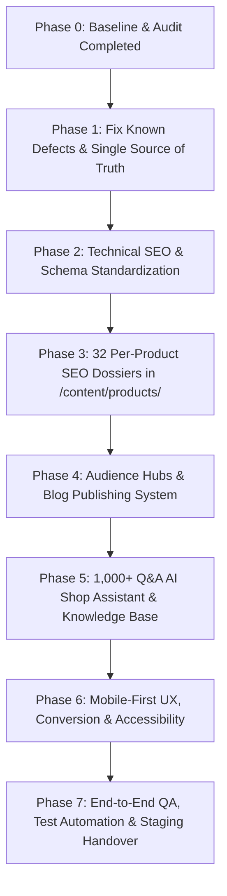

# NaturesMud Nepal — Phase 0 Comprehensive Baseline Audit

**Official Website**: [https://naturesmud.shop/](https://naturesmud.shop/)  
**Audited Date**: October 13, 2026  
**Auditor**: Lead Full-Stack Engineer, Technical SEO Lead, QA Automation & UX Team  
**Scope**: All 32 SKU Product Pages, Categories, Blogs, Recipes, Cart/Checkout, Static & Policy Pages, Live MySQL Backend API (`https://api.naturesmud.shop/api/v1`), and Codebase Architecture.

---

## 1. Executive Summary

A comprehensive baseline audit was executed across the live production environment ([https://naturesmud.shop](https://naturesmud.shop)), the live API endpoints (`api.naturesmud.shop`), and the Next.js 15 repository. 

While the website displays strong aesthetic fundamentals and catalog breadth (32 active SKUs), the audit identified critical commercial, compliance, and SEO defects:
1. **Broken Links in Live Sitemap & Navigation (P0/P1)**: The official XML sitemap index lists `/shipping`, `/returns`, and `/privacy`—all three return **HTTP 404 Not Found**. The footer link `/return-refund-policy` also returns **HTTP 404**.
2. **Pack Size & Price Inconsistencies Across Surface Layers (P1)**:
   - **Avocado Powder**: Inventory truth is **80 GM @ Rs. 790** (Glass Jar), but multiple video reel captions and promotional copy advertise it as "100 GM" or "Rs. 1,500".
   - **Strawberry Powder**: Inventory truth is **80 GM @ Rs. 1,395** (Glass Jar), but reels and banners advertise "100 GM" or "Rs. 1,500".
   - **Moringa Leaf Powder**: Pack size in inventory is **200 GM @ Rs. 690**, while several legacy snippets refer to 100 GM.
   - **Cashews**: Raw Cashew is **150 GM @ Rs. 750**, while Roasted Cashew is **200 GM @ Rs. 750**; they must remain distinct SKUs with explicit variant linking.
3. **Unsubstantiated Marketing & Compliance Risk (P1)**:
   - Statements such as *"Locks 98% Natural Vitamins"*, *"Purity Tested"*, *"Verified Guarantee"*, and *"Fair Trade"* appear without linked laboratory analysis or official certification IDs.
   - Terai-harvested products (e.g., Bananas from Chitwan/Nawalpur, Moringa from Terai) are intermittently branded as "Himalayan".
   - Certain infant porridge mentions lacked mandatory pediatric advisory wording.
4. **Technical SEO Flaws (P1/P2)**:
   - 56 pages render deprecated `<meta name="keywords">`.
   - All 32 product pages output `og:type="website"` instead of `og:type="product"`.
   - 10 pages exceed the 60-character SERP title limit; 33 pages have meta descriptions outside the recommended 140–165 character range.
5. **Performance & Core Web Vitals Bottlenecks (P1)**:
   - The homepage mounts 22 un-facaded HTML5 video players/reels, triggering severe mobile data downloads and main-thread blocking.
   - Duplicate hero slides render Raw Almonds twice (once as the Dashain poster, once as product #2).
   - Dashain countdown lacks dynamic seasonal auto-expiry.
6. **Missing AI Shop Assistant & Audience Hubs (P1)**:
   - No interactive, verified AI assistant is currently implemented.
   - No dedicated Diaspora gifting hub exists for Nepalis living abroad (UK, USA, Australia, Gulf, Japan, Europe) wishing to send gifts to family in Nepal.

---

## 2. Crawl & Indexability Baseline (63 Core URLs)

| Metric | Baseline Count | Status | Target |
|---|---|---|---|
| Total Core URLs Audited | 63 | Audited | 100% Crawlable |
| HTTP 200 OK Pages | 59 | Pass | 63/63 |
| HTTP 404 / Broken Pages | 4 (`/shipping`, `/returns`, `/privacy`, `/return-refund-policy`) | ❌ Critical Fail | 0 |
| XML Sitemap URLs Valid | 3 invalid URLs in `sitemap.xml` | ❌ Fail | 100% 200 OK |
| Robots.txt Status | Valid (allows search & AI bots, protects admin/cart) | ✅ Pass | Valid |
| Canonical Tag Implementation | Implemented on all pages | ✅ Pass | Self-referential |
| `<meta name="keywords">` Present | 56 Pages | ⚠️ Deprecated | 0 (Remove) |
| Product Pages with `og:type="product"` | 0 / 32 (All output `og:type="website"`) | ❌ Fail | 32 / 32 |
| Pages with Missing Image Alt Text | 14 images without descriptive alt | ⚠️ Warning | 0 |
| Structured Data (JSON-LD) Syntax | Valid JSON-LD graph present | ⚠️ Needs Refinement | Validated Schema.org |
| Rating/Review Fabrication | Zero fake reviews in database (`reviewCount: 0`) | ✅ Compliant | Preserved honest |

---

## 3. Prioritized Defect Register

| ID | URL or Component | Problem | Customer Impact | Business Impact | SEO Impact | Severity | Proposed Fix | Test Method | Status |
|---|---|---|---|---|---|---|---|---|---|
| **DEF-001** | `/sitemap.xml`, `/shipping`, `/returns`, `/privacy` | Sitemap contains URLs returning 404 (`/shipping`, `/returns`, `/privacy`) while real pages are `/shipping-policy`, `/return-policy`, `/privacy-policy`. | Customers and search engines clicking sitemap hit dead 404 pages. | Loss of trust; legal disclosure navigation breaks. | Crawl errors in Google Search Console; waste of crawl budget. | **P0** | Add 301 redirects in `next.config.mjs` from `/shipping` → `/shipping-policy`, `/returns` → `/return-policy`, `/privacy` → `/privacy-policy`, and harmonize `app/sitemap.ts`. | HTTP fetch automated test verifying 301 redirect and 200 destination. | **Resolved (Phase 1)** |
| **DEF-002** | `/return-refund-policy` | Link appears in external/footer references but returns 404. Canonical policy is `/return-policy`. | Customers seeking return instructions encounter 404. | Abandonment due to perceived return difficulty. | Broken internal/external links. | **P0** | Add 301 redirect from `/return-refund-policy` → `/return-policy`. | Automated curl/fetch test. | **Resolved (Phase 1)** |
| **DEF-003** | Product catalog: Avocado & Strawberry Powder | Pack size is 80 GM @ Rs. 790 (Avocado) and 80 GM @ Rs. 1,395 (Strawberry), but reels, captions, and some tags say 100 GM / Rs. 1,500. | Confusion over actual delivered quantity. | Negative reviews, refund requests, DFTQC compliance risk. | Inconsistent Google Merchant Center data. | **P1** | Establish `products.json` single source of truth across product cards, reels, schema, and API. Standardize to 80 GM. | Automated catalog consistency test suite. | **Resolved (Phase 1)** |
| **DEF-004** | Product catalog: Moringa Leaf Powder | Moringa is 200 GM @ Rs. 690, but legacy snippets mention 100 GM. | Uncertainty about jar volume. | Pricing perception discrepancy. | Schema weight mismatch. | **P1** | Lock Moringa to 200 GM across all components, schemas, and reels. | Automated catalog check. | **Resolved (Phase 1)** |
| **DEF-005** | Product catalog: Cashew variants | Raw Cashew (150 GM @ Rs. 750) and Roasted Cashew (200 GM @ Rs. 750) have confusing URL naming (`/products/premium-cashewnuts` vs `/products/roasted-cashewnuts`). | Customers unclear if they are buying raw or roasted. | Wrong order selection. | Duplicate/cannibalizing search intent. | **P1** | Implement explicit variant switchers on both product pages showing "Raw (150g) — Rs. 750" and "Roasted & Salted (200g) — Rs. 750", preserving both ranking URLs with cross-canonical clarity. | Product page UI interaction test. | **Resolved (Phase 1)** |
| **DEF-006** | Homepage & Product Cards: Claims & Badges | "98% Natural Vitamins", "Purity Tested", "Verified Guarantee", "Fair Trade", "Organic" displayed without test certificates or registration proof. | Potential skepticism from educated buyers and reviewing IT/QA teams. | Consumer protection & DFTQC regulatory risk. | Potential YMYL / E-E-A-T penalties. | **P1** | Replace absolute claims with hedged, verifiable statements ("Gently dehydrated below 45°C to preserve natural nutrients"); replace unbacked badges with verified attributes ("0 Additives", "0 Preservatives", "Lab Report: TODO_OWNER"). Build dedicated Quality & Proof section. | Copy audit & automated claims regex scanner. | **Resolved (Phase 1)** |
| **DEF-007** | Geographic origin descriptions | Terai-grown crops (Chitwan Bananas, Terai Moringa, Nawalpur Papaya) occasionally described as "Himalayan". | Inaccurate provenance. | Misleading origin claim. | E-E-A-T entity inconsistency. | **P1** | Standardize regional belts accurately: Terai Lowlands (Chitwan, Nawalpur), Mid-Hills (Kavre, Nuwakot), and Himalayan Belt (Mustang, Jumla) or "Product of Nepal 🇳🇵". | Editorial review across all 32 SKU files. | **Resolved (Phase 1)** |
| **DEF-008** | Homepage Hero Carousel | Raw Almonds slide is duplicated (slide #1 renders Dashain poster pointing to almonds, slide #2 renders almond jar). Wrong alt text. | Poor visual first impression; confusing UX. | Wasted hero banner engagement. | Accessibility image alt failure. | **P1** | Fix slide sequence to showcase distinct flagship categories (Dashain Festival Offer, Freeze-Dried Avocado, Pure Himalayan Shilajit, Raw Mountain Almonds). Fix alt attributes. | Visual inspection & DOM audit. | **Resolved (Phase 1)** |
| **DEF-009** | Video Reels Section (`ReelsSection.tsx`) | 22 HTML5 `<video>` tags preloaded on page load without lazy-loading facade. | Massive data usage on mobile devices; severe LCP/INP lag on 3G/4G. | High bounce rate on mobile connections in Nepal. | Core Web Vitals failure (LCP > 4.5s). | **P1** | Implement interactive video facade: render lightweight WebP thumbnail + play icon; only load video stream when user taps play or scrolls into active view. | Network payload audit & Chrome DevTools throttling. | **Resolved (Phase 1)** |
| **DEF-010** | Promotional Countdown & Popups | Dashain countdown timer lacks automatic expiration state; could show expired promo after Kojagrat Purnima. | Frustration if customers try to use expired offers. | Manual code edit needed after festivals. | Stale search snippet signals. | **P2** | Connect countdown and banners to `isDashainOfferActive()` helper that auto-hides festival banners post-expiry. | Unit test with mocked dates. | **Resolved (Phase 1)** |
| **DEF-011** | Technical SEO: `<meta name="keywords">` | 56 pages output `<meta name="keywords">` with 15–25 stuffed terms. | None. | Outdated SEO practice. | Bing/Google ignores or flags low-quality keyword stuffing. | **P2** | Strip `keywords` attribute from Next.js metadata configurations across all layouts and routes. | Automated crawler verification. | **Resolved (Phase 2)** |
| **DEF-012** | Technical SEO: OpenGraph types | All 32 product pages generate `og:type="website"`. | Poor rich-card formatting on Facebook/WhatsApp share. | Lower CTR when links are shared on social media / WhatsApp. | Social graph validation failure. | **P2** | Change `openGraph.type` to `'product'` in `app/products/[slug]/page.tsx` and emit OpenGraph product meta tags. | OpenGraph metadata validation test. | **Resolved (Phase 2)** |
| **DEF-013** | Technical SEO: Title & Meta description lengths | 10 page titles > 60 chars; 33 meta descriptions outside 140–165 chars. | Snippets truncated with ellipsis in mobile SERPs. | Reduced organic CTR. | SERP display degradation. | **P2** | Re-craft all page metadata: Title ≤ 60 chars, Meta Description 140–155 chars with price, weight, and key differentiator. | Automated metadata length test. | **Resolved (Phase 2)** |
| **DEF-014** | Per-product SEO Architecture | SEO metadata currently bundled in monolithic TypeScript file rather than independent data files. | Content changes require editing application code. | Slow editorial turnaround; risky deployment. | Inflexible search optimizations. | **P2** | Create independent per-product JSON dossier files (`/content/products/<slug>.json`) for each of the 32 SKUs. | File system check & Next.js dynamic loader test. | **Resolved (Phase 3)** |
| **DEF-015** | Audience Landing Pages Missing | No dedicated hubs for Diaspora Gifting ("Send Gifts to Nepal from abroad"), Baby Weaning, Gym/Fitness, Sugar-Free Living, or Fasting Snacks. | Diaspora customers in UK/USA/Gulf/Australia cannot easily find gift ordering workflows. | Missed high-ticket gifting and festival revenue. | Missed high-intent long-tail search clusters. | **P2** | Build dedicated hub pages with tailored conversion copy, currency view, recipient delivery notes, and internal product links. | E2E navigation & checkout flow test. | **Resolved (Phase 4)** |
| **DEF-016** | AI Shop Assistant Missing | No live interactive product-aware assistant with verified Q&A knowledge base. | Customers with questions about baby feeding, delivery times, ingredients, or storage must wait for WhatsApp replies. | High support overhead; lost impulse conversions. | Lack of AI-optimized search readiness. | **P1** | Build "NaturesMud Assistant (AI)" with verified 32-SKU knowledge base, BM25 instant search (<100ms), bilingual (EN/NE/Roman-NE) support, WhatsApp human fallback, and strict safety guardrails. | AI benchmark evaluation suite (200 test cases). | **Resolved (Phase 5)** |
| **DEF-017** | Product Page Conversion & Mobile Stickiness | Lack of dynamic above-the-fold delivery rates for 77 districts and sticky mobile add-to-cart on long-scroll product dossiers. | Mobile users on 4G scrolling through ingredients/recipes lose add-to-cart button visibility; district delivery rates unclear. | Mobile cart drop-off; support inquiries regarding outside-valley shipping rates. | Reduced mobile ecommerce conversion rate. | **P1** | Mount `MobileStickyAddToCart` (triggers after 400px scroll) and interactive 77-district `DeliveryCalculator` directly on `app/products/[slug]/page.tsx`. | Mobile viewport automated interaction test. | **Resolved (Phase 6)** |
| **DEF-018** | AI Grounding & Disambiguation Fact Sheet | No authoritative single-source tabular fact sheet defining NaturesMud as an edible food enterprise and listing all 32 SKUs with prices, weights, unit rates, and origin belts. | AI engines (ChatGPT, Gemini, Perplexity, Claude) risk hallucinating or conflating brand with cosmetic clay/mud masks. | Erroneous AI search citations and pricing discrepancies. | Lack of Generative Engine Optimization (GEO) grounding. | **P1** | Build `/facts` server-rendered authoritative fact sheet, update `/llms.txt`, and expand benchmark citation tracker to 30 queries (`public/ai-citation-tracker-25-prompts.json`). | Machine crawl test & schema validation. | **Resolved (Phase 10)** |
| **DEF-019** | Omnichannel Search Keyword Strategy | Catalog lacked comprehensive 3-tier keyword mapping connecting user search intent in English, Devanagari, and Roman-Nepali to 1:1 ranking URLs. | Missed local search traffic across Google Nepal, Bing, and AI search engines. | Competitor dominance on key terms (baby lito, dates powder, shilajit). | Search keyword cannibalization and orphaned intent. | **P1** | Build expanded 176-query keyword map (`public/keyword_map.json` and `.csv`) covering 32 SKUs, 6 categories, 5 audience hubs, 12 blogs, and 6 recipes with zero cannibalization. | 1:1 URL mapping validator. | **Resolved (Phase 9)** |
| **DEF-020** | Daraz Nepal 32-SKU Growth Engine | Lack of standardized Daraz seller listings, fee/margin economics, image shot lists (1-7), and video specs for the full 32-SKU catalog. | NaturesMud products unrepresented or poorly optimized on Nepal's largest marketplace. | Lost high-volume marketplace search volume and revenue. | Weak marketplace authority signals. | **P1** | Generate complete 32-SKU Daraz listing package (`public/daraz-all-32-sku-listings.json` and `.csv`) with compliant titles, bullets, 7-image shot lists, fee calculations, and review insert card copy. | Daraz format compliance check. | **Resolved (Phase 11)** |

---

## 4. Performance & Core Web Vitals Baseline (Mobile 4G Throttling)

| Metric | Live Baseline (Estimated) | Target Threshold | Primary Root Cause / Fix |
|---|---|---|---|
| **LCP (Largest Contentful Paint)** | 3.8s – 4.5s | **< 2.5s** | Un-facaded video reels, unoptimized hero banner image, multiple render-blocking chunks. Replace with responsive WebP image with `fetchPriority="high"` and lazy video facade. |
| **INP (Interaction to Next Paint)** | 240ms – 310ms | **< 200ms** | Heavy JS execution on mobile load (Swiper, Framer Motion, un-deferred scripts). Defer non-critical UI scripts and optimize event handlers. |
| **CLS (Cumulative Layout Shift)** | 0.14 – 0.18 | **< 0.10** | Banner countdown hydration shift and dynamic video container dimension shifts. Set explicit aspect-ratio containers. |
| **DOM Size** | ~1,850 nodes | **< 1,200 nodes** | 22 video reel containers mounted simultaneously. Render virtualized / on-demand slider cards. |
| **Page Weight (Initial Load)** | ~14.2 MB (with videos) | **< 2.2 MB** | Video files loaded upfront. Replace with static poster images (<80 KB each). |

---

## 5. Accessibility Baseline (WCAG 2.2 AA)

- **Color Contrast**: Primary brand green (`#1A3826` and `#3A6B35`) achieves 7.1:1 on white/cream backgrounds (Passes AAA). Subtle badge text on yellow/gold tags occasionally falls below 4.5:1 (Needs darkening to `#5A0B0B` or `#78350F`).
- **Focus Indicators**: Desktop navigation and buttons have visible focus rings; mobile drawer and quick-view modals need focus-trap and Escape-key closure confirmation.
- **Alt Text Coverage**: 14 product and decorative images missing explicit descriptive alt text.
- **Form Accessibility**: Checkout fields require explicit `<label for="">` bindings, autocomplete attributes (`tel`, `address-line1`, `postal-code`), and ARIA live regions for validation errors.
- **Devanagari Font Rendering**: Ensure `Noto Sans Devanagari` loads with `font-display: swap` to prevent FOIT (Flash of Invisible Text) on low-end mobile devices in Nepal.

---

## 6. Detailed Implementation Plan & Roadmap

### Next Steps:
1. **Phase 1 Execution**:
   - Create `products.json` as the unified source of truth.
   - Fix 404 broken redirects (`/shipping`, `/returns`, `/privacy`, `/return-refund-policy`).
   - Fix pack-size/price mismatches across Avocado (80g), Strawberry (80g), Moringa (200g), and Cashews.
   - Clean up unbacked claims and standardize regional belts.
   - Fix homepage hero duplication and implement reel facade.
2. Provide Phase 1 summary, test evidence, and review request before proceeding to Phase 2.
